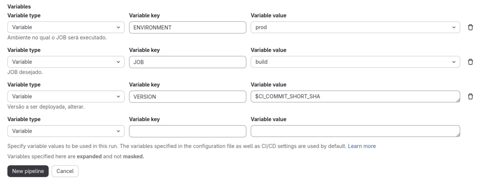
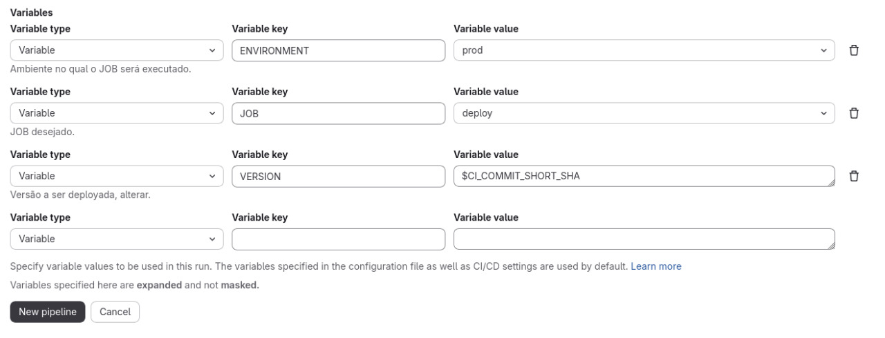
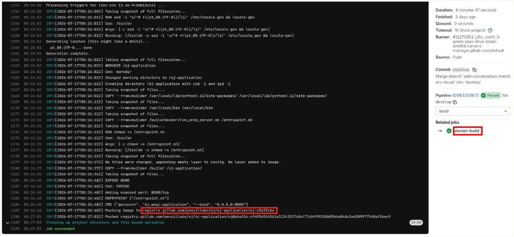

==============
Pipeline da EJ
==============

.. contents:: Índice
   :local:
   :depth: 2

Esta documentação explica o funcionamento do pipeline de CI/CD, os estágios de execução, quais regras acionam cada etapa e como rodar processos manuais.

1. Stages
---------

A pipeline é composta por **5 estágios principais**:

1. ``build``: Constrói a imagem Docker da aplicação usando o Kaniko e envia para o Container Registry.
2. ``deploy``: Atualiza os servidores de homologação ou produção com as novas versões.

----

2. Rules
--------

As regras são definidas previamente para facilitar a visualização dos fluxos.

.. code-block:: yaml

   r1: &push_dev $CI_PIPELINE_SOURCE == 'push' && $CI_COMMIT_BRANCH == 'develop'
   r2: &job_build $JOB == 'build'
   r3: &merge_request $CI_PIPELINE_SOURCE == 'merge_request_event'
   r4: &job_deploy $JOB == 'deploy'

* **r1:** Ocorre um push para a branch principal, que atualmente é a develop
* **r2:** O job do tipo "build" é acionado :ref:`manualmente <acionar-jobs-manualmente>`
* **r3:** Um commit é feito em um Merge Request
* **r4:** O job do tipo "deploy" é acionado manualmente

----

3. Jobs
-------

Build
^^^^^

Atualmente essa etapa serve apenas para deploys via Registry.

* **``docker-build``:** Usa a ferramenta **Kaniko** (que permite construir imagens de forma segura dentro de containers) para ler o ``docker/Dockerfile-prod``, gerar a imagem e subir (push) para o Registry do próprio GitLab (``$CI_REGISTRY``)
* *Como acionar:* Execute a pipeline manualmente definindo a variável ``JOB`` como ``build``

Deploy
^^^^^^

Temos duas estratégias de deploy configuradas:

1. **``deploy-local``:** Deploy para o ambiente de homol. No servidor o ambiente de homol foi configurado a partir do clone do repositório disponível na branch develop. O job faz um ``git fetch`` e ``checkout`` direto do repositório, efetuando o build localmente via ``docker compose up --build``.
   
   *Como acionar:* Rodará *automaticamente* ao dar *push* na branch ``develop``.

2. **``deploy-registry``:** Estratégia de deploy para o ambiente de prod. O servidor baixa a imagem já compilada diretamente do Registry do GitLab, atualiza a tag no arquivo ``ej.yaml`` do servidor e sobe os containers usando ``docker compose``. Esse job depende de um build prévio.
   
   *Como acionar:* Execute a pipeline *manualmente* definindo a variável ``JOB`` como ``deploy``, garantindo que você selecionou o ``ENVIRONMENT`` correto e a ``VERSION`` (versão da imagem) gerada pelo build prévio.

----

.. _acionar-jobs-manualmente:

4. Acionar jobs manualmente
---------------------------

A pipeline será acionada manualmente via interface do GitLab (**Build > Pipelines > New pipeline**) alterando a variável ``JOB``.

Algumas variáveis já estão pré-definidas. Aqui está o que cada uma faz e como preenchê-las:

.. list-table:: 
   :widths: 15 25 15 45
   :header-rows: 1

   * - Variável
     - Opções / Valores
     - Padrão
     - Descrição
   * - **``JOB``**
     - ``none``, ``build``, ``deploy``, ``unit tests``
     - ``none``
     - **Obrigatório para rotinas manuais.** Define qual ação a pipeline deve forçar. Se quiser construir a imagem, escolha ``build``. Se quiser atualizar o servidor, escolha ``deploy``.
   * - **``ENVIRONMENT``**
     - ``homol``, ``prod``
     - ``prod``
     - O ambiente de destino onde o deploy será realizado.
   * - **``VERSION``**
     - *Ex: ``c5623c6a``*
     - ``$CI_COMMIT_SHORT_SHA``
     - A versão (Tag da imagem Docker) que será feito o deploy ou a tag de identificação para build. Por padrão, usa o hash curto do commit atual.

**Exemplo para build:**

Com o valor padrão ``$CI_COMMIT_SHORT_SHA`` a imagem será construída com o hash do commit da branch atual como tag.

**Exemplo para deploy:**

Com o valor padrão ``$CI_COMMIT_SHORT_SHA``, será feito o deploy da imagem construída a partir do último commit da branch atual. Se desejar fazer deploy de uma versão específica, alterar o campo para o hash gerado em outro build:

Podemos ver nesse job de build qual é o hash da versão gerada.